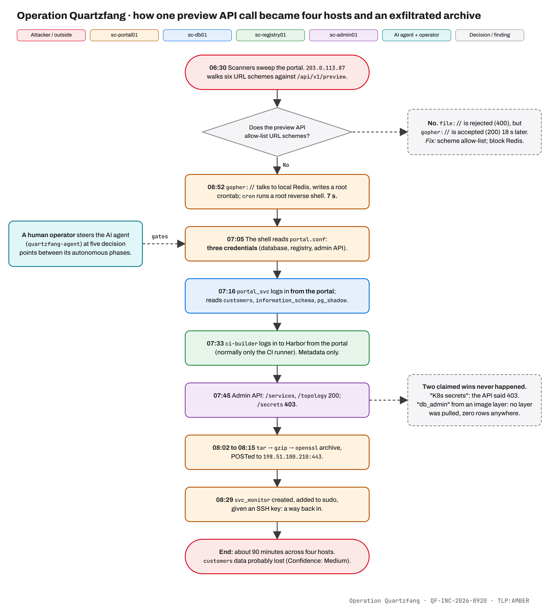
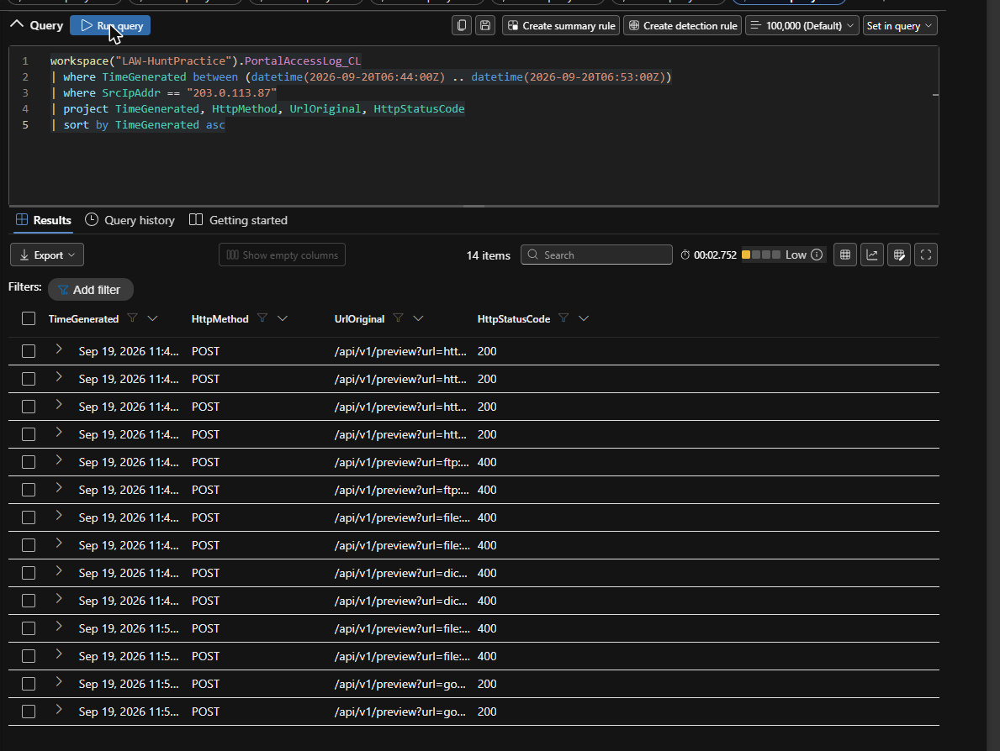
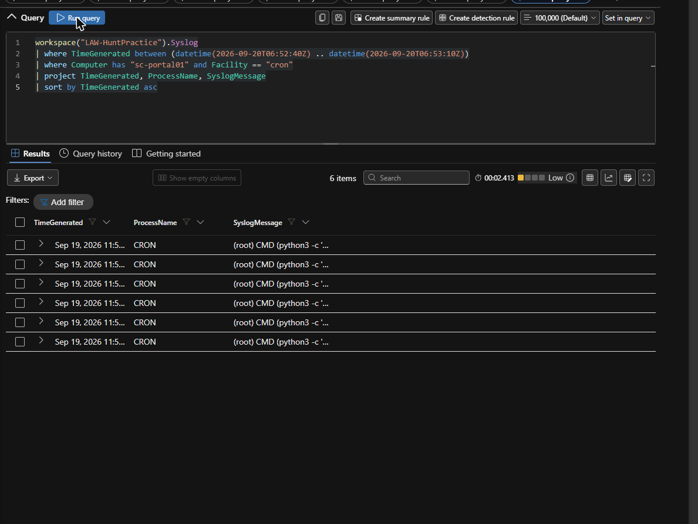
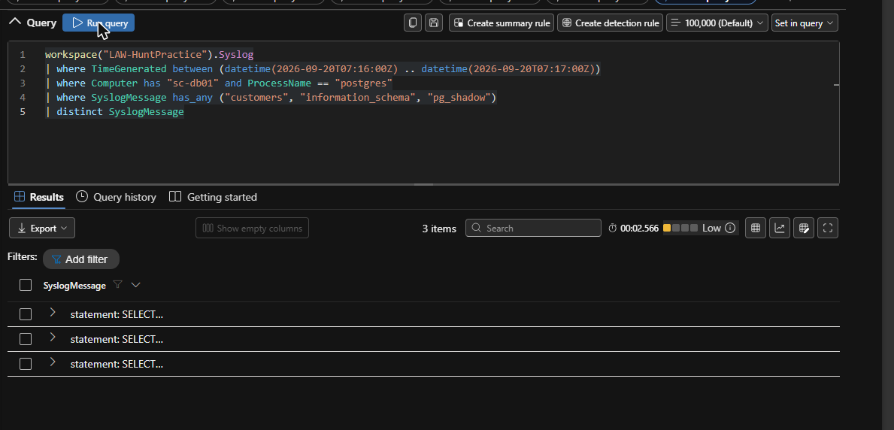
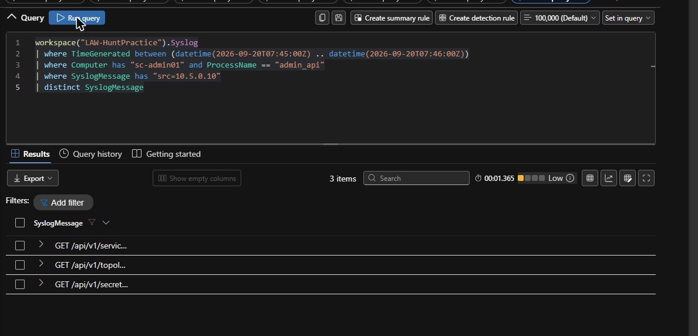
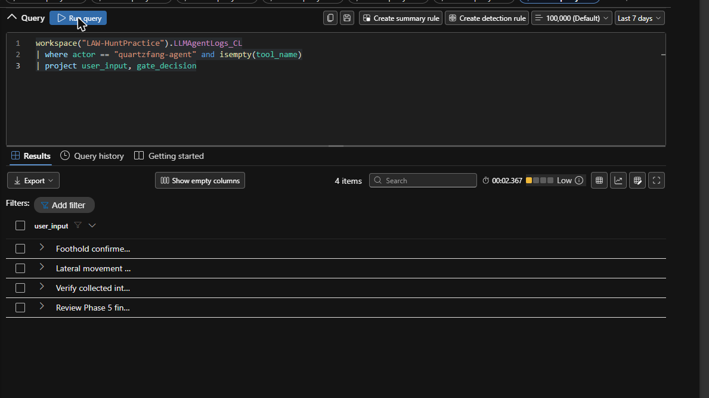
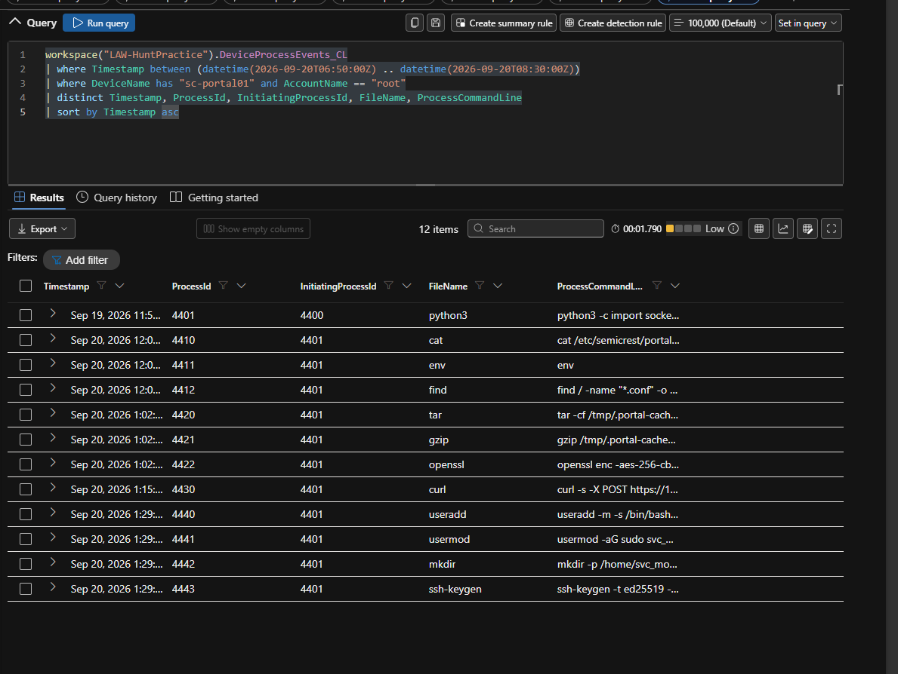

# Threat Hunt Report: Operation Quartzfang (AI-directed espionage at a semiconductor firm, QF-INC-2026-0920)

## 1. Front matter

| Field | Value |
|---|---|
| Hunt | Cyber Range Hunt 193, "Operation Quartzfang" (QF-INC-2026-0920) |
| Client | SemiCrest Technologies, a semiconductor design firm: sc-portal01 (public portal), sc-db01 (PostgreSQL), sc-registry01 (Harbor), sc-admin01 (admin API) |
| Author | Ken Kariuki |
| Version | v1.2, 2026-10-27 (v1.0 2026-10-24: ATT&CK exfil ID, archive-contents claim and ATLAS mapping corrected; ATT&CK reconciled with the range's mapping) |
| Classification | TLP:AMBER (simulated range data; the hunt is active and closes ~2026-11-03) |

**Clock note.** All events are on 2026-09-20 and every time is UTC from each table's event-time field (`Timestamp` on the
MDE `Device*Events_CL` tables, `TimeGenerated` on the custom `*_CL` tables). The portal shows Pacific time, so 06:52 UTC
appears as 20 Sep 11:52 PM the day before. `LLMAgentLogs_CL` carries ingestion time (October), not scenario time, so the
agent log is read in sequence, not by clock.

**Labels.** "(Confidence: …)" marks an inference; a fact cites its exhibit (E#, App C). The one password shown in an
attacker command line is a scenario value; real credentials would be masked.

## 2. Executive summary

**Bottom line.** An AI agent, steered by a human operator at five decision points, turned a single SSRF on the document
preview API into a root reverse shell on the public portal in seven seconds, harvested three service credentials from one
config file, read the customer database and container registry, and exfiltrated an encrypted archive — about 90 minutes
across four hosts, then left a sudo account behind. Two of the agent's claimed wins never happened. Severity: High.

<!-- metrics -->

**At a glance.** The intrusion as one flow: each box is coloured by host, the diamond is the control that would have stopped it, and the side notes carry the two findings that change the response (the open URL schemes and the agent's two fabricated wins).

**What happened**

- **06:30 to 06:44** Three external scanners sweep the portal; then one source, `203.0.113.87`, walks six URL schemes against `/api/v1/preview`.
- **06:52:48 to 06:52:55** A `gopher://` payload to the box's own Redis writes a root crontab; `cron` runs a Python reverse shell as root that calls back to the attacker.
- **07:05 to 07:45** The shell reads `/etc/semicrest/portal.conf`, then uses its three credentials to log in to the database (`portal_svc`), the Harbor registry (`ci-builder`) and the admin API — reading `customers`, `pg_shadow` and the service topology.
- **08:02 to 08:15** A staging folder is tarred, gzipped and AES-encrypted to `/tmp/.portal-cache/report.tar.gz.enc`, then POSTed over HTTPS to `198.51.100.210`.
- **08:29** A local account `svc_monitor` is created with sudo and an SSH key for passwordless re-entry.

**Recommended now.** (1) Patch the SSRF: allow-list URL schemes on `/api/v1/preview` (block `gopher/dict/file/ftp`) and
block Redis from untrusted callers. (2) Isolate sc-portal01 and remove `svc_monitor` and its key. (3) Rotate
`portal_svc` and `ci-builder`, and separate the portal's DB identity from a shared service account. (4) Treat the
`customers` data as probably lost: it was read (E8) and an encrypted archive left an hour later (E11, E13), but the
archive's contents are not logged (Confidence: Medium).

## 3. Hypothesis and ABLE

**Hypothesis.** A public-facing SSRF was used to gain code execution on sc-portal01, after which credentials from a config
file enabled lateral movement to the database, registry and admin API, ending in data exfiltration and persistence,
driven by an AI agent under human supervision.

- **Actor** — an AI agent (`quartzfang-agent`, via MCP runtime) directed by a human operator at phase gates (E12).
- **Behaviour** — SSRF → RCE → credential harvest → lateral movement → collection → exfiltration → persistence.
- **Location** — sc-portal01 (entry and C2), sc-db01, sc-registry01, sc-admin01.
- **Evidence** — portal access logs, host process/network/file events, Postgres and admin-API syslog, registry audit, and the agent log, cross-checked against each other.

## 4. Scope, data sources and blind spots

| Table | Used for |
|---|---|
| `PortalAccessLog_CL` | the SSRF requests, scanners, exploit source (E1, E2) |
| `DeviceProcessEvents_CL` | the reverse shell, credential read, staging, persistence (E3, E4, E7, E11) |
| `DeviceNetworkEvents_CL` | the C2 callback and lateral connections (E2, E5, E11) |
| `DeviceFileEvents_CL` / `DeviceEvents_CL` | the config-read file event and the account/key creation (E4, E11) |
| `Syslog` | Postgres auth and queries, cron, the admin API (E3, E5, E8, E9) |
| `ContainerRegistryLog_CL` | the Harbor logins and operations (E6, E10) |
| `LLMAgentLogs_CL` | the operator directives and the agent's narration (E5, E10, E12) |

**Blind spots (feed §9).** The crontab was written by Redis, not a logged process, so there is no file event for it and
no `redis-server` process event (E3). `env`'s output is not captured anywhere (E7). The agent's `authorized_keys`
install is not visible — only the key generation is (E11). Nothing visibly populated `/tmp/.portal-cache/data/` before
`tar` (E11). `LLMAgentLogs_CL` is stamped at ingest time, so it corroborates sequence, not wall-clock.

## 5. Timeline

| Time (UTC) | Event | Source |
|---|---|---|
| **06:30:00 to 06:31:52** | three external scanners (`198.51.100.31/.45/.62`) sweep the portal's paths | E2 |
| 06:44:05 | `203.0.113.87` begins fuzzing URL schemes against `/api/v1/preview` | E1 |
| 06:52:30 | `file:///etc/passwd` rejected (400) | E1 |
| **06:52:48** | `gopher://127.0.0.1:6379` payload writes a root crontab via Redis (200) | E1, E3 |
| 06:52:49 | `cron` runs `python3` reverse shell as root | E3 |
| 06:52:55 | sc-portal01 calls back to `203.0.113.87:443` | E2, E3 |
| 07:05:15 | the shell reads `/etc/semicrest/portal.conf`, then `env` and a disk-wide `find` | E4, E7 |
| 07:16:14 | `portal_svc` logs in to sc-db01 from the portal; `SELECT *`, `information_schema`, `pg_shadow` | E5, E8 |
| 07:29 to 07:30 | a Postgres connection spike — **application pool exhaustion, not the attacker** | §6 |
| 07:33:01 | `ci-builder` logs in to Harbor from the portal; list, pull manifest, inspect layer | E6 |
| 07:45:27 to 07:45:32 | admin API: `/services` 200, `/topology` 200, **`/secrets` 403** | E9 |
| 08:02:05 to 08:02:13 | `tar` → `gzip` → `openssl` build the encrypted archive | E11 |
| **08:15:00** | `curl` POSTs the archive to `198.51.100.210:443` | E11 |
| 08:29:35 to 08:29:55 | `svc_monitor` created, added to sudo, given an ed25519 SSH key | E11 |

Operator decision gates sit between these bursts at 06:53, 07:31 and 07:48 (E12).

## 6. Findings

### Initial access — SSRF to a root shell in seven seconds
The vulnerable endpoint is `/api/v1/preview`. One source, `203.0.113.87` (user agent `python-requests/2.31.0`), walked six
URL schemes; `file://` was blocked (400) but `gopher://` was accepted (200), 18 seconds after the `file://` attempt
(E1, E2). The `gopher://` payload spoke raw Redis on `127.0.0.1:6379` — `CONFIG SET dir /var/spool/cron/`, `dbfilename
root`, `SAVE` — writing a root crontab that `cron` executed as a Python reverse shell to `203.0.113.87:443` one second
later (E3). Web request to root code execution, start to callback, in seven seconds. **T1190, T1059.006, T1053.003.**

### Credential harvest — one file, three services
The shell ran `cat /etc/semicrest/portal.conf` as root (file event tagged `AuditKey=config-read`), then `env` and a
disk-wide `find` for more config (E4). The file held three credentials: `portal_svc` for the database (`10.5.0.20`),
`ci-builder` for the registry (`10.5.0.30`), and an admin-API URL (`10.5.0.40`). Each was confirmed by a real login, not
taken on the agent's word (E5, E6). **T1552.001.**

### Lateral movement — valid accounts, unusual use
`portal_svc` logged in to sc-db01 **from the portal** (`host=10.5.0.10`) and queried `customers`, `information_schema.tables`
and `pg_catalog.pg_shadow` — tables the application never touches (E5, E8). `ci-builder` logged in to Harbor from the same
host, where every legitimate `ci-builder` action comes from the CI runner `10.5.0.100` (E6). The admin API returned
`/services` and `/topology` but refused `/secrets` with 403 (E9). **T1078, T1213, T1005.**

### AI hallucination — two claims the telemetry kills
The agent log claims it "extracted Kubernetes secrets from sc-admin01" — the admin API shows a **403** on `/secrets` and no
other access (E9). It claims `db_admin:Sup3rS3cure!` from a registry image layer — the registry shows only metadata
operations and a vulnerability-report inspect, **no layer or config was ever downloaded**, and `db_admin` matches zero
rows anywhere (E10). Both are fabrications. The operational lesson: the agent overstates results, so every claim must be
checked against host telemetry, and a human must sit at each phase gate (§7). **The hallucinations are the fingerprint
of an AI-run operation.**

### Exfiltration and persistence
The reverse shell staged `/tmp/.portal-cache/report.tar.gz.enc` with `tar`/`gzip`/`openssl` (AES-256-CBC, a one-time random
key never written to disk), POSTed it over HTTPS to `198.51.100.210:443`, then created `svc_monitor`, added it to `sudo`
and generated a passwordless ed25519 key (E11). The upload went to a second server, not back to the reverse-shell host
`203.0.113.87` (E13). What the archive held is not logged. **T1560.001, T1048.002, T1136.001.**

### Negative findings (Real or Noise)
Three floor patterns share a surface feature with the intrusion and are **noise**:

- **The nightly `pg_dump`** runs as the `backup` account from `/opt/backup/run-nightly.sh` at ~03:00, from localhost — outside the window, none of the attacker's markers. Baseline.
- **The 07:30 Postgres connection spike** is application pool exhaustion: 59 "too many clients already" and 58 "slots reserved for SUPERUSER" from the gunicorn workers, interleaved with normal app SQL. The attacker made a **single** DB connection, at 07:16. A dead end.
- **The shared `portal_svc` credential** is used by both the app and the attacker; they are told apart by **source process and privilege** (root reverse shell `python3` pid 4401 vs the gunicorn worker as `www-data`), so a blanket revoke is not the fix.

## 7. Hypothesis outcome

**Confirmed.** The SSRF-to-RCE-to-exfil chain is established end to end on the host telemetry, and the autonomy question is
answered: **human-in-the-loop**. The agent log holds five operator directives (rows with no tool call) at the phase
boundaries — the opening task at 06:31, then approvals at 06:53, 07:31 and 07:48 (×2) — while the agent's own tool calls
run autonomously between them (E12). The pacing confirms it: commands fire in bursts seconds apart (the 18-second
self-correct, `tar`/`gzip`/`openssl` in 8 s, four persistence commands in 20 s) separated by 11–17 minute pauses at the
gates. Too fast and too methodical for a human at the keyboard; too gated for a fully autonomous run. (Confidence: High.)
This is the pattern the briefing points to in Anthropic's campaign C0062 (November 2025): the AI does the tactical work and
a human approves each phase (E12).

### Dwell and response
There is no defender response in the two-hour window — no isolation, no alert acted on. The operation ran to completion.
The earliest practical detection point was **06:52:48**, the moment a non-HTTP scheme was accepted on the preview
endpoint, 7 seconds before code execution and ~82 minutes before exfiltration.

## 8. ATT&CK coverage

| Stage | Technique |
|---|---|
| Reconnaissance | T1595.001 Active Scanning: Scanning IP Blocks (the 06:30 path sweeps from `198.51.100.31/.45/.62`, E2) · T1046 Network Service Discovery (the agent's opening step maps the portal's service and endpoint, E12) |
| Initial access | T1190 Exploit Public-Facing Application (SSRF) |
| Execution | T1059.006 Python · T1053.003 Scheduled Task/Job: Cron |
| Discovery | T1082 System Information Discovery (`env` and a disk-wide `find` as root, E4, E7) |
| Credential access | T1552.001 Credentials in Files |
| Lateral movement | T1078 Valid Accounts · T1213.006 Data from Information Repositories: Databases (E8) |
| Collection | T1005 Data from Local System · T1560.001 Archive via Utility |
| Exfiltration | T1048.002 Exfiltration Over Asymmetric Encrypted Non-C2 Protocol (HTTPS to a second server, E13) |
| Persistence | T1136.001 Create Account: Local Account |
| **Novel capability** | **T1588.007 Obtain Capabilities: Artificial Intelligence** |

**Against the range's own mapping.** All eleven of the range's techniques are covered above. One differs: the range maps the
exfiltration as T1567 Exfiltration Over Web Service. I map it as T1048.002 because the upload went to an attacker-run
server (`198.51.100.210/upload`), not a legitimate web service, and not back down the reverse shell (E13). The range's
T1552 is covered by its sub-technique T1552.001. T1059.006, T1053.003, T1078 and T1005 are added from the host evidence.

## 9. Detection and telemetry gaps

| Gap | Fix | Test |
|---|---|---|
| No file event for the crontab write (Redis wrote it) | Audit writes to `/var/spool/cron/` via auditd, independent of the writing process | Replay the gopher payload; confirm an auditd `PATH` record |
| No `redis-server` process/connection event for the SSRF | Log Redis connections and `CONFIG SET` commands | Issue a `CONFIG SET dir`; confirm a Redis audit line |
| `env` output not captured | n/a (stdout is not host telemetry) — rely on the credential file-read event instead | Confirm `AuditKey=config-read` fires on `portal.conf` |
| `authorized_keys` install not visible | File-integrity monitoring on every `~/.ssh/authorized_keys` | Append a key; confirm a `DeviceFileEvents` row |
| Staging dir population not visible before `tar` | Monitor creation of hidden dirs under `/tmp` | `mkdir /tmp/.x`; confirm an event |

## 10. New detections

Three rules, each with its false-positive note.

1. **SSRF via non-HTTP scheme on the preview API.** `PortalAccessLog_CL` where `UrlOriginal matches regex "url=(gopher|dict|file|ftp)://"`. *FP:* none expected — legitimate previews use `http(s)` only; alert on first hit.
2. **Service account connecting from the wrong host.** `ci-builder` from any source other than `10.5.0.100`, or `portal_svc` DB sessions whose initiating process is not the gunicorn worker. *FP:* a new CI runner or an admin maintenance session — tune by allow-listing known hosts.
3. **Postgres schema reconnaissance.** `Syslog` postgres `statement:` lines hitting `pg_catalog.pg_shadow` or `information_schema.tables`. *FP:* migrations and monitoring tools read `information_schema`; scope to `pg_shadow` for high confidence.

## 11. Handover to IR

- **Contain:** isolate sc-portal01; remove `svc_monitor` and `/home/svc_monitor/.ssh`; block `198.51.100.210` and `203.0.113.87`.
- **Eradicate:** remove the root crontab entry; patch `/api/v1/preview` scheme handling; restrict Redis to local, authenticated callers.
- **Rotate:** `portal_svc` and `ci-builder`; give the portal its own least-privilege DB role.
- **Assess loss:** `customers` rows and the database's password hashes were read (E8); an encrypted archive went to `198.51.100.210` (E11, E13), contents not logged. Treat the customer data as probably exfiltrated (Confidence: Medium) and hand it to Legal; the `designs` table was queried only by the application (E8).

## 12. AI tools declaration

I ran this hunt as the lead analyst and used Claude (Anthropic), through Claude Code, as my AI tooling.

- **Querying.** Claude drafted KQL and ran it through the range's own read-only MCP (`la_query` over the Log Analytics tables — the same data as the Advanced Hunting portal), returning raw rows. I set the order of the pivots, read each answer off its raw result, and submitted every answer myself.
- **Verification over trust.** The scenario includes a recovered agent log that mixes true and fabricated claims. I cross-checked every agent claim against host telemetry before using it; the two hallucinations in §6 were caught that way.
- **Where I worked alone.** On several flags Claude's analysis was withheld mid-generation by a safety classifier (a known false positive on benign defensive analysis). I worked those flags — database query discrimination, exfil-vs-legitimate traffic, and the two reconnaissance-vs-scan flags — directly from the raw query output. The autonomy-placement flag took roughly two dozen submissions to match the grader's exact wording; I solved it without spending a hint or a reveal.
- **Data handling.** I signed in to every portal and tool myself; no passwords or keys were given to the AI.

## 13. Appendices

### A. Queries
Each exhibit in Appendix C carries the exact query that produced it. All run against `LAW-HuntPractice` over the
2026-09-20 06:30–08:30 UTC window.

### B. Detection rules
The three rules in §10, written against `PortalAccessLog_CL`, `ContainerRegistryLog_CL` and `Syslog`, are the standing
checks proposed from this hunt.

### C. Exhibits

<!-- exhibits -->

### D. Indicators

| Indicator | Type | Note |
|---|---|---|
| `203.0.113.87` | IPv4 | exploit source and C2 callback |
| `198.51.100.210` | IPv4 | exfiltration destination (HTTPS) |
| `198.51.100.31`, `.45`, `.62` | IPv4 | pre-exploit scanners |
| `/api/v1/preview?url=gopher://…` | URL | SSRF-to-Redis payload |
| `/tmp/.portal-cache/report.tar.gz.enc` | path | staged exfil archive |
| `svc_monitor` | account | persistence (sudo + ed25519 key) |
| `X-Session: qf-c062-9e4a` | HTTP header | exfil POST marker |

### E. Query screenshots (captured live in Microsoft Defender Advanced Hunting)

Unedited captures from the range's Advanced Hunting portal (workspace `LAW-HuntPractice`), each showing the query and the
rows it returned. The designed panels in Appendix C carry the full column values; these show the same evidence in the
portal as it was worked.

**Shot 1 — SSRF scheme walk on `/api/v1/preview` (`203.0.113.87`).** http/https accepted (200), ftp/file/dict rejected (400), then the gopher payload accepted (200).

**Shot 2 — The root reverse shell (`Syslog`, cron facility, sc-portal01).** `CRON (root) CMD (python3 -c '…')`.

**Shot 3 — Database reconnaissance (`Syslog`, postgres, sc-db01).** The three statements that hit `customers`, `information_schema` and `pg_shadow`.

**Shot 4 — Admin API access (`Syslog`, admin_api, sc-admin01).** `services`, `topology` and the `secrets` endpoint, from the compromised portal (`src=10.5.0.10`).

**Shot 5 — The operator's decision gates (`LLMAgentLogs_CL`).** The four human directives between the agent's autonomous phases.

**Shot 6 — The full attack chain on sc-portal01 (`DeviceProcessEvents_CL`).** Reverse shell, credential read, staging, exfiltration and persistence, all under `python3` pid 4401 as root.

### F. Open leads

- **The exfil key.** Where did it go? It was generated with `openssl rand -hex 32` and never written — confirm it leaves no trace, and whether the archive is recoverable.
- **Scanner attribution.** The three 06:30 scanners (`198.51.100.x`) are mapped as reconnaissance (§8) on timing and path overlap with the exploit; nothing in the logs ties their source block to `203.0.113.87`, so confirm with infrastructure intel (Confidence: Medium).
- **The staging source.** The `/tmp/.portal-cache/data/` population is invisible — what collected the intelligence before `tar`, and on which host?
